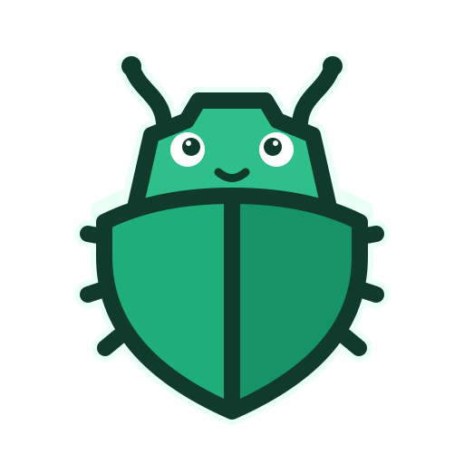

<p align="center"></p>

<h1 align="center">Shieldbug</h1>

<p align="center"><b>AI 해킹은 AI가 막아야지, 내 토큰으로 쓰는 AI 백신</b></p>

A daily security check for people who use AI coding agents. It runs on **the AI you already pay for** (Claude Code, Codex, Antigravity, or an API key), so it costs almost nothing. It is open source, so you can read exactly what it does.

> Status: **early alpha (v0.1.0)**. Tested on Windows 11 with Claude Code. macOS, Linux, and the Codex, Antigravity and API-key adapters are written but not yet tested. It is a daily check of your setup, not a replacement for antivirus.

[한국어 설명은 아래에 있습니다.](#한국어)

## What it does

1. **Collects facts locally, without AI.** It looks at AI agent settings and MCP servers, skills and plugins, plaintext keys and tokens, and installed tools.
2. **Redacts them.** Keys, tokens, passwords, your user name, host name, email and public IP are removed. A gate blocks the send if anything key-shaped survives. You can see exactly what was sent (`shieldbug payload`).
3. **Asks your own AI, twice.**
   - The **intel** call searches the web for this week's AI-related attacks. It never sees anything from your machine.
   - The **analysis** call sees the redacted facts with **every tool switched off**, so it can only answer in text.
4. **Shows the result** in a small local dashboard: a score, findings and how to fix each one.

It **never fixes anything by itself** and **never stays resident**. Your OS scheduler runs it once a day, and the dashboard exists only while it is open.

First comes a **self-check that cannot be turned off**: a security tool that runs every day with your trust must not become the attack. It confirms, without AI, that the program file matches the official release checksum, that the daily task and the shortcuts run this program, that the AI CLIs it starts are not in a temporary or Downloads folder, and that your own checks contain no text that steers the AI. If the program file or the daily task is wrong, the run stops there.

Then five core checks, chosen because they need an AI's judgement rather than a pattern match (each can be turned off): an agent that reads outside content and acts on it without asking, MCP servers, skills and plugins from sources you cannot verify, hooks that do more than they should, hidden orders in instruction files, and installed tools named in today's advisories. Simple pattern rules (bypass flags, `curl | sh` hooks, tokens in plain files) still run, but as evidence for those five, not as findings of their own. General PC hygiene (ports, firewall, disk encryption) is left to your OS and antivirus. The checklist grows: when a new attack pattern appears, your AI proposes a new check and you approve or reject it.

## Download

One file, no Go needed. Get it from [Releases](https://github.com/qruse/shieldbug/releases/latest):

- **Windows:** `shieldbug-windows-x64.exe`. Open it: it installs itself to `%LOCALAPPDATA%\Programs\Shieldbug` (no admin), adds a desktop icon and a Start menu entry, and opens the dashboard. Delete the downloaded file afterwards. The file is not code-signed yet, so SmartScreen may ask: **More info → Run anyway**.
- **macOS:** `shieldbug-macos-apple-silicon.tar.gz` (M1 and later) or `-intel`. Unpack it, then right-click `shieldbug` → **Open** (not signed yet). It installs to `~/Library/Application Support/Shieldbug` and adds Shieldbug to `~/Applications`.
- **Linux:** `tar xzf shieldbug-linux-x64.tar.gz && ./shieldbug`. It installs to `~/.local/bin`.

Opening a newer download replaces the installed copy; an open dashboard picks it up on its next refresh. Check a file with `SHA256SUMS.txt`.

You also need one AI you already use: `claude` (Claude Code), `codex` or `agy` (Antigravity) signed in, or an API key in `ANTHROPIC_API_KEY`, `OPENAI_API_KEY` or `GEMINI_API_KEY`.

## Build from source

You need [Go 1.27+](https://go.dev/dl/) and at least one of: `claude` (Claude Code), `codex`, `agy` (Antigravity), or an API key in `ANTHROPIC_API_KEY`, `OPENAI_API_KEY` or `GEMINI_API_KEY`.

```bash
go install github.com/qruse/shieldbug@latest
shieldbug doctor      # checks redaction and that the AI cannot use tools
shieldbug check       # runs one check now
shieldbug             # opens the dashboard
```

The first `shieldbug` adds a desktop icon and a search entry (Start menu, Spotlight, app list). From a clone, build first: `go build -o shieldbug.exe .` (Windows; `-ldflags "-H=windowsgui"` hides the console window) or `go build -o shieldbug .`. `go run .` works for a quick look, but it adds no icon or schedule because its program file is temporary.

Other commands: `shieldbug help`. Data lives in `~/.shieldbug/`. `shieldbug uninstall` removes the schedule, shortcuts and all data.

**Cost.** One daily check with Claude Sonnet 5.5 at low effort used about 55 seconds and about $0.11 of usage in our test, counted against your own subscription or key.

## Contributing

Anyone can share cases, propose checklist items and vote. Only reviewed items reach users' machines. See [CONTRIBUTING.md](CONTRIBUTING.md).

## License

Code: [Apache 2.0](LICENSE). Checklist content: [CC BY 4.0](checklist/LICENSE). "Shieldbug" is a trademark of hslab ([NOTICE](NOTICE)).

---

## 한국어

AI 코딩 도구를 쓰는 사람을 위한 **하루 한 번 보안 점검**입니다. 이미 돈을 내고 쓰는 AI(Claude Code, Codex, Antigravity, 또는 API 키)로 돌아가서 비용이 거의 들지 않고, 오픈소스라 무엇을 하는지 전부 볼 수 있습니다.

> 상태: **초기 알파 (v0.1.0)**. Windows 11과 Claude Code에서만 시험했습니다. 백신을 대신하는 게 아니라, 내 PC 설정의 구멍을 매일 찾아 주는 점검입니다.

**하는 일**
1. **AI 없이 PC에서 사실을 모읍니다.** AI 에이전트 설정과 MCP 서버, 스킬·플러그인, 평문으로 놓인 키와 토큰, 설치된 도구를 봅니다.
2. **가립니다.** 키·토큰·비밀번호·사용자 이름·이메일·공인 IP를 지웁니다. 키처럼 생긴 게 남아 있으면 아예 보내지 않습니다. 보낸 내용은 대시보드에서 그대로 볼 수 있습니다.
3. **내 AI에게 두 번 묻습니다.**
   - 뉴스 조사 호출은 이번 주 AI 관련 공격을 웹에서 찾고, 내 PC 정보는 전혀 보지 않습니다.
   - 분석 호출은 가린 자료만 보고, **도구가 하나도 없어서** 글로만 답할 수 있습니다.
4. **결과를 보여 줍니다.** 가벼운 로컬 대시보드에 점수, 발견 사항, 고치는 법이 나옵니다.

**절대 스스로 고치지 않고, 계속 떠 있지도 않습니다.** 점검 전에 **끌 수 없는 자가 점검**이 먼저 돕니다. 매일 신뢰받으며 도는 보안 도구가 공격 통로가 되면 안 되니까요. 프로그램 파일이 공식 배포본 체크섬과 같은지, 매일 점검 예약과 바로가기가 이 프로그램을 실행하는지, 실행하는 AI CLI가 임시·다운로드 폴더에 있지 않은지, 내 점검 항목에 AI를 조종하는 문장이 없는지 AI 없이 확인합니다. 프로그램 파일이나 예약이 바뀌어 있으면 거기서 멈춥니다. 그다음 기본 점검 5개가 돕니다(각각 끌 수 있음). 단순 검사로는 못 잡고 AI가 판단해야 하는 것만 골랐습니다: 외부 글을 읽고 묻지 않고 행동하는 에이전트, 출처를 확인할 수 없는 MCP 서버·스킬·플러그인, 해야 할 일 이상을 하는 훅, 지시 파일 속 숨은 지시, 오늘의 보안 경고에 해당하는 도구. 우회 플래그·`curl | sh` 훅·평문 토큰 같은 단순 규칙도 돌지만, 따로 지적하지 않고 이 5개를 판단하는 근거로만 씁니다. 포트·방화벽·디스크 암호화 같은 일반 PC 점검은 OS와 백신의 몫으로 둡니다. 점검목록은 새 공격이 나올 때마다 AI가 항목을 제안하고 내가 승인하면서 자랍니다.

**설치:** [Releases](https://github.com/qruse/shieldbug/releases/latest)에서 파일 하나만 받으면 됩니다. Go는 필요 없습니다.
- Windows는 `shieldbug-windows-x64.exe`를 받아서 실행하세요. 관리자 권한 없이 `%LOCALAPPDATA%\Programs\Shieldbug`에 스스로 설치하고, 바탕화면 아이콘과 시작 메뉴 항목을 만든 뒤 대시보드를 엽니다. 받은 파일은 지워도 됩니다.
- 아직 코드 서명이 없어서 SmartScreen이 막으면 **추가 정보 → 실행**을 누르세요. macOS는 압축을 풀고 `shieldbug`를 오른쪽 클릭 → **열기**로 실행하세요.
- 새 버전 파일을 받아서 열면 설치된 것이 바뀌고, 열려 있는 대시보드는 새로고침할 때 새 버전으로 넘어갑니다.
- 이미 쓰고 있는 AI 하나는 있어야 합니다: Claude Code, Codex, Antigravity 중 로그인된 것, 또는 API 키.

소스에서 빌드하는 방법은 위 영어 섹션과 같습니다. 참여 방법은 [CONTRIBUTING.md](CONTRIBUTING.md)를 보세요.
